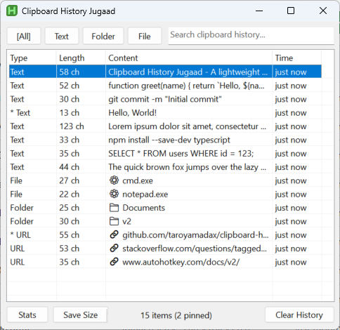

# Clipboard History Jugaad

**English** | [日本語](README.ja.md)

A small, compact clipboard-history popup written in **AutoHotkey v2**,
inspired by the old (small-window) version of *Clipboard History Mini*.



"Jugaad" (जुगाड़) is Hindi for a clever, make-do fix built from whatever is at
hand — which is exactly what this tool is.

## Why not just Win+V?

Windows 10/11 has a built-in clipboard history (`Win+V`), but:

| | Win+V | This tool |
|---|---|---|
| **Keyboard** | Requires Win key — awkward on HHKB, 60% boards, and compact layouts | `Ctrl+Shift+H` by default (no Win key needed, easily remappable) |
| **Search** | No search box | Live search to filter hundreds of clips instantly |
| **Install** | Built-in | Single `.exe` (~1 MB), no install, fully portable |
| **Sync** | Syncs to Microsoft account (optional) | 100% local — nothing leaves your machine |
| **Images** | ✅ Supported | ❌ Text-only (use Win+V for images) |

If you're on a compact keyboard without a convenient Win key, or you just want
faster search and offline-only history, this tool is for you.

## Features

- Compact window (720 x 420 by default) with a classic native Windows look
- Live search box (type to filter)
- Filter tabs: **All / Text / Folder / File**
  - **Text** — plain text clips (excludes Folder/File)
  - **Folder** — clips that are an existing folder path
  - **File** — clips that are an existing file path
- ListView columns: **Type | Length | Content | Time**
  - `Length` is the character count of the clip (e.g. `17 ch`, `1.2 Kch`)
  - `Type` is auto-detected per clip: `Text` / `Folder` / `File` / `URL`
    (pinned items are prefixed with `*`)
  - Type, Length, Time are 70px each; Content auto-expands to fill remaining width
  - Content shows emoji + short name for non-text items:
    - Folder: 📁 + folder name
    - File: emoji by extension (📊 Excel, 📝 Word, 📽️ PPT, 📕 PDF, 🖼️ image, 🎬 video, 🎵 audio, 📦 archive, 💻 code, ⚙️ exe, 📄 other) + filename
    - URL: 🔗 + domain/path
- Pin, delete, copy, paste — plus **Open** for folder / file / URL clips
- **Open** launches the shell: folders in Explorer, files in their default
  app, URLs in the default browser
- History persisted to `history.json` next to the script
- **Auto-expiry**: non-pinned items older than 24 h are deleted at startup
  and hourly thereafter (pinned items are kept forever)
- Tray menu toggle to **run at startup** (Windows login)
- **Save Size** button to persist window size (position auto-saved on close)

> Images are **not supported** (the tool is text-only). For image clipboard
> history, use the OS feature `Win+V`.

## Requirements

- Windows 10 / 11
- **AutoHotkey v2.0** (not v1.1)
  - Download: https://www.autohotkey.com/download/
  - Or via winget:
    ```powershell
    winget install --id AutoHotkey.AutoHotkey -e
    ```

## Run

### Prebuilt exe (recommended, no AHK install required)

Download `ClipboardHistoryJugaad.exe` from [Releases](https://github.com/taroyamadax/clipboard-history-jugaad/releases) and double-click.

> ⚠️ Windows SmartScreen may show a warning (unsigned exe).
> Click "More info" → "Run anyway" to proceed.

### From source

Double-click `ClipboardHistoryJugaad.ahk`, or:

```powershell
& "C:\Program Files\AutoHotkey\v2\AutoHotkey64.exe" "ClipboardHistoryJugaad.ahk"
```

The script runs in the tray and starts watching the clipboard immediately.

## Tray menu

Right-click the tray icon:

| Item               | Action                                            |
|--------------------|---------------------------------------------------|
| `Open`             | open the popup                                    |
| `Run at startup`   | toggle auto-start at login (checkmark = enabled)  |
| `Exit`             | quit                                              |

`Run at startup` creates/removes a shortcut in the user's Startup folder
(`shell:startup`). No admin rights, no registry changes, fully reversible.

## Shortcuts

| Key           | Action                                      |
|---------------|---------------------------------------------|
| `Ctrl+Shift+H`| open the popup                              |
| type          | live search / filter                        |
| `Up` / `Down` | move selection                              |
| `Enter`       | paste the selected item                     |
| `Ctrl+C`      | copy selected item to clipboard (no paste)  |
| `Ctrl+O`      | open selected folder / file / URL           |
| `Ctrl+P`      | pin / unpin selected item                   |
| `Del`         | delete selected item                        |
| `Esc`         | close the popup                             |

Right-clicking a row shows a context menu. For folder / file / URL clips an
**Open** entry appears at the top.

### Search box and the IME

While the **search box** has focus, `Enter` does **not** paste — it just moves
focus into the list. This is deliberate: it lets you confirm a Japanese (IME)
kanji conversion with `Enter` without accidentally triggering a paste. Press
`Enter` again (now in the list) to paste.

> `Ctrl+Shift+H` ("H" = History) is chosen for keyboards without a Win key
> (e.g. HHKB) and avoids SakuraEditor's `Ctrl+Alt+H`. While the script is
> running the hotkey is global, so it may shadow a same-key app shortcut (some
> browsers use `Ctrl+Shift+H` for home/history). If it conflicts, change
> `hotkey` in the `CFG` block at the top of the script (e.g. `"^!v"`
> Ctrl+Alt+V, or `"!v"` Alt+V).

## Configuration

Edit the `CFG` object at the top of `ClipboardHistoryJugaad.ahk`:

| Key           | Meaning                              | Default    |
|---------------|--------------------------------------|------------|
| `hotkey`      | hotkey to open the popup             | `^+h`      |
| `maxItems`    | max stored history items             | `200`      |
| `maxPreview`  | preview length (chars) in Content    | `200`      |
| `winW/winH`   | default window size                  | 720 / 420  |
| `minW/minH`   | minimum window size                  | 420 / 240  |
| `rememberPos` | restore last window position too     | `true`     |
| `pinnedFirst` | show pinned items at the top         | `true`     |
| `expireHours` | auto-delete non-pinned items older than this (hours) | `24` |
| `purgeOnStartup` | enable auto-expiry (startup + hourly) | `true`   |
| `saveFile`    | history JSON path                    | script dir |
| `winStateFile`| window size/position JSON path       | script dir |

## Type auto-detection

Each clip's `Type` is computed on the fly (not stored), so `history.json`
stays backward compatible:

- `Folder` — a single-line, existing folder path
- `File`   — a single-line, existing file path
- `URL`    — starts with `http(s)://`, `ftp://` or `file://`
- `Text`   — anything else (incl. multi-line text)

Surrounding double quotes (as produced by Explorer's "Copy as path") are
stripped before detection, so quoted paths are still recognised.

## Notes / Limitations

- **Text-only.** Image and file-list clipboard entries are ignored by the
  watcher.
- The paste action temporarily replaces the clipboard, sends `Ctrl+V`, then a
  self-fire guard (`g_IgnoreClip`) prevents the tool's own write from being
  re-recorded.
- `history.json` uses a minimal hand-written reader/writer that matches this
  script's own output format (not a general JSON parser).
- `history.json` is stored **in plain text**. Anything you copy — including
  passwords, tokens or credentials — is written to disk as-is. Keep this in
  mind, and clear sensitive items (`Del`) when needed.

## Auto-expiry

To stop the history growing without bound, non-pinned items older than
`CFG.expireHours` (24 h by default) are purged automatically:

- **When**: once at startup, then every hour via `SetTimer` (so a long-lived
  tray instance keeps itself tidy even if the PC is never restarted).
- **What survives**: pinned items are never deleted regardless of age. Items
  with a blank timestamp are also kept (their age can't be judged).
- **Measure**: strictly 24 h of elapsed time (not a calendar-day boundary) —
  an item copied at 09:00 expires at 09:00 the next day.
- **Disable**: set `purgeOnStartup: false` in the `CFG` block (no code
  removal needed); tune the lifetime with `expireHours`.
